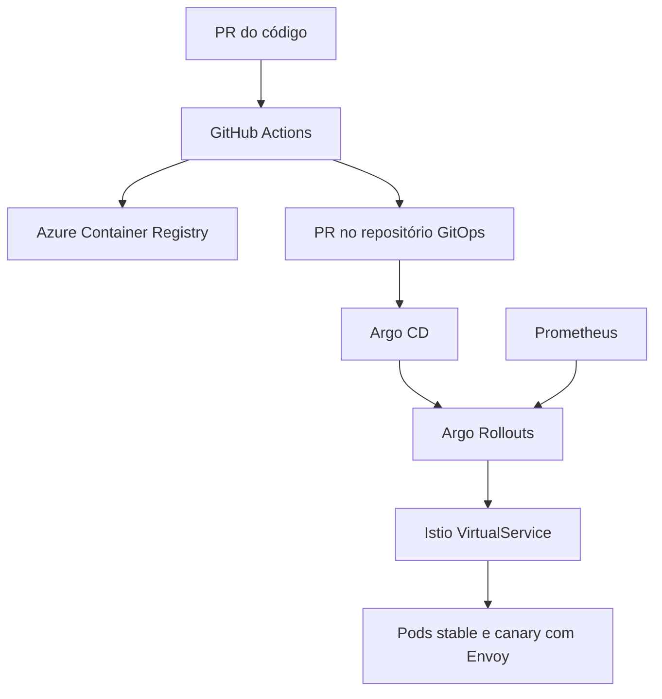

# AKS + Istio/Envoy + Argo Rollouts + Argo CD

Projeto de referência para entregar uma aplicação no AKS com GitOps e canary progressivo.

Neste projeto, **Istio no modo Envoy** significa o modo tradicional `sidecar`: cada Pod da aplicação recebe um `istio-proxy` Envoy, e o tráfego externo entra por um Istio Ingress Gateway também baseado em Envoy. Não é o modo ambient.

O bootstrap assume **Istio upstream autogerenciado por Helm**. Se o AKS já estiver com o add-on gerenciado de Istio habilitado, não instale um segundo control plane; o chart da aplicação continua aproveitável, mas namespace, revision label e gateway devem ser ajustados aos recursos do add-on.

## Arquitetura



## O que está incluído

- instalação por Helm de Istio `1.31.2`, Argo CD, Argo Rollouts e kube-prometheus-stack;
- Istio Ingress Gateway publicado por um Azure Load Balancer;
- Helm chart do aplicativo usando um `Rollout` e dois Services, `stable` e `canary`;
- etapas `10% → 25% → 50% → 100%`;
- `AnalysisTemplate` com volume mínimo, taxa de sucesso e latência P95;
- `PodMonitor` para métricas dos sidecars Envoy;
- mTLS `STRICT` para o workload;
- `Application` do Argo CD preparado para os campos que o Rollouts altera;
- workflow do repositório de código para publicar no ACR e abrir PR no GitOps;
- workflow de validação do chart no repositório GitOps;
- workflow opcional e somente leitura para acompanhar o Rollout.

## Estrutura dos dois repositórios

### Repositório 1: código da aplicação

```text
application-repository/
├── Dockerfile
├── src/
└── .github/workflows/
    └── build-and-update-gitops.yml
```

Copie `workflows/source-repository/build-and-update-gitops.yml` para `.github/workflows/` desse repositório.

Responsabilidades:

1. testar o código no Pull Request;
2. depois do merge em `main`, autenticar no Azure por OIDC;
3. gerar uma imagem com tag igual ao SHA do commit;
4. publicar imagem e SBOM no ACR;
5. atualizar tag e digest no repositório GitOps;
6. abrir um Pull Request de implantação.

O workflow usa `push` em `main`, e não o evento de aprovação do PR. Na prática, ele só executa depois que o PR aprovado foi integrado, e não entrega código de uma branch ainda não confiável.

### Repositório 2: GitOps

Este pacote representa o conteúdo inicial desse repositório:

```text
gitops-repository/
├── argocd/
│   ├── application.yaml
│   └── project.yaml
├── charts/rollout-app/
├── environments/prod/values.yaml
├── platform/
├── workflows/
└── docs/
```

Responsabilidades:

- armazenar o estado desejado do cluster;
- versionar chart, configuração e imagem implantada;
- permitir revisão específica de produção;
- ser observado pelo Argo CD.

## Fluxo completo

1. Um desenvolvedor abre PR no repositório da aplicação.
2. Os testes obrigatórios são executados.
3. O PR é aprovado e integrado em `main`.
4. `build-and-update-gitops.yml` constrói e publica `imagem:<commit-sha>` no ACR.
5. O digest retornado pelo ACR também é gravado em `environments/prod/values.yaml`.
6. O workflow abre um PR no repositório GitOps.
7. O workflow `Validate Helm chart` executa lint e renderização.
8. Depois da aprovação e merge do PR GitOps, o Argo CD detecta o commit.
9. O Argo CD aplica o novo `Rollout`.
10. O Argo Rollouts cria a nova ReplicaSet canary.
11. O controller atualiza os seletores dos Services e os pesos do `VirtualService`.
12. Em cada gate, o `AnalysisTemplate` consulta o Prometheus.
13. Se as métricas forem aprovadas, o canary avança; se falharem, o rollout é abortado e o tráfego permanece na versão estável.

## Por que dois Services

O Argo Rollouts acrescenta dinamicamente o `rollouts-pod-template-hash` aos seletores dos dois Services:

```text
Service stable  -> ReplicaSet estável
Service canary  -> ReplicaSet nova
```

O `VirtualService` envia tráfego aos dois hosts e começa em `100/0`. Durante o rollout, os pesos são alterados para `90/10`, `75/25`, `50/50` e `0/100`.

## Por que o Application do Argo CD é necessário

O `Application` é necessário quando o Argo CD deve observar e sincronizar este chart. Ele pode ser criado manualmente uma única vez ou por um padrão App-of-Apps/ApplicationSet já existente.

Ele possui duas exceções importantes:

- ignora somente os campos `weight` do `VirtualService`;
- ignora somente `rollouts-pod-template-hash` no seletor dos Services.

Esses campos pertencem operacionalmente ao Argo Rollouts. O restante dos recursos continua sob controle do Argo CD. As opções `RespectIgnoreDifferences=true` e `ApplyOutOfSyncOnly=true` evitam reaplicações que fariam o tráfego oscilar durante o canary.

## Pré-requisitos no AKS

- acesso administrativo inicial ao cluster;
- Helm 3 e kubectl;
- ACR existente;
- AKS com permissão `AcrPull` no ACR;
- StorageClass `managed-csi` ou ajuste equivalente;
- DNS apontando para o IP do Istio Ingress Gateway;
- certificado TLS no namespace `istio-ingress` antes de produção.

O Metrics Server já faz parte do AKS e não é reinstalado por este projeto.

## Instalação dos controladores

Confira as versões em `platform/versions.env`, conecte o kubectl ao AKS e execute:

```bash
export PUBLIC_HOST=app.seudominio.com.br
chmod +x platform/bootstrap.sh
./platform/bootstrap.sh
```

O bootstrap instala o Gateway HTTP para permitir o primeiro teste. Para produção, substitua-o pelo conteúdo de `platform/manifests/public-gateway-tls.yaml.example`, criando antes o Secret TLS `public-gateway-tls` em `istio-ingress`.

Para usar um Azure Load Balancer interno, descomente a annotation em `platform/values/istio-ingress.yaml`.

## Personalizações obrigatórias

Substitua os placeholders nestes arquivos:

| Arquivo | Ajuste |
|---|---|
| `environments/prod/values.yaml` | ACR, nome da imagem, domínio e recursos |
| `argocd/project.yaml` | URL do repositório GitOps |
| `argocd/application.yaml` | URL do repositório, nome da aplicação e namespace |
| `platform/values/argo-cd.yaml` | domínio do Argo CD, se for exposto |
| `platform/manifests/public-gateway-tls.yaml.example` | domínio e Secret TLS |
| workflow do repositório de código | Variables, Environment e GitHub App |

## Aplicar o Application

Depois de enviar este conteúdo para o repositório GitOps e cadastrar o repo no Argo CD:

```bash
kubectl apply -f argocd/project.yaml
kubectl apply -f argocd/application.yaml
```

Não execute `helm upgrade` manualmente para a aplicação depois que o Argo CD assumir o gerenciamento.

## Prometheus e os gates

O `AnalysisTemplate` consulta `istio_requests_total` e `istio_request_duration_milliseconds_bucket` filtrando:

- nome canônico do serviço;
- namespace;
- revisão correspondente à tag ou digest da imagem canary.

Critérios padrão:

| Gate | Valor |
|---|---:|
| Tráfego mínimo | `0,01 req/s` |
| Taxa de sucesso | `>= 99%` |
| P95 | `<= 500 ms` |
| Amostras por gate | `5` |
| Falhas toleradas | `2` |

Esses valores são iniciais. Ajuste-os com base nos SLOs e no volume real. O gerador de tráfego não faz parte do chart: sem requisições, o gate de tráfego mínimo falha propositalmente.

## TLS e segurança

- mantenha a aplicação como `ClusterIP`;
- exponha apenas o Istio Ingress Gateway;
- use HTTPS no Gateway antes de produção;
- mantenha mTLS `STRICT` entre o gateway e a aplicação;
- habilite `AuthorizationPolicy` somente depois de conferir o namespace e ServiceAccount do ingress gateway;
- não armazene secrets no repositório GitOps em texto puro;
- use Azure Key Vault + Secrets Store CSI Driver, External Secrets ou SOPS;
- use OIDC no GitHub Actions e GitHub App entre os repositórios;
- use tags imutáveis e digest da imagem.

## Validação local

```bash
chmod +x scripts/validate.sh
./scripts/validate.sh
```

## Arquivos complementares

- `docs/azure-and-github-setup.md`: identidades, variáveis e permissões;
- `docs/operations.md`: acompanhar, abortar, promover e reverter;
- `workflows/gitops-repository/observe-rollout.yml.example`: acompanhamento opcional com acesso somente leitura ao AKS.

## Versões fixadas em 21/10/2026

| Componente | Versão |
|---|---:|
| Istio | `1.31.2` |
| Argo Rollouts chart | `2.43.8` |
| Argo Rollouts app | `1.10.1` |
| Argo CD chart | `10.10.5` |
| kube-prometheus-stack | `92.11.0` |

Antes de atualizar, revise notas de versão e faça o upgrade primeiro em um ambiente não produtivo.

## Referências oficiais

- Istio Helm: <https://istio.io/latest/docs/setup/install/helm/>
- Argo Rollouts com Istio: <https://argo-rollouts.readthedocs.io/en/stable/features/traffic-management/istio/>
- Argo CD multiple sources: <https://argo-cd.readthedocs.io/en/stable/user-guide/multiple_sources/>
- Azure e GitHub OIDC: <https://learn.microsoft.com/azure/developer/github/connect-from-azure>
- AKS e ACR: <https://learn.microsoft.com/azure/aks/cluster-container-registry-integration>

